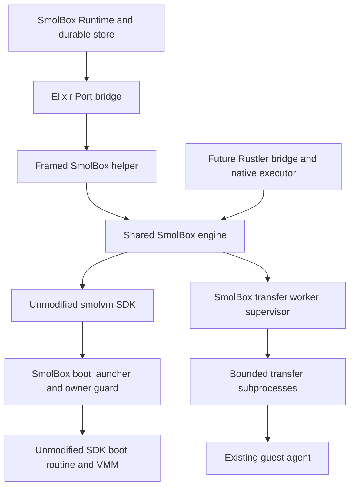

# Embedded Port design with an unmodified SDK

Status: implemented and ordinarily qualified, October 12, 2026. Replaces the
five downstream smolvm patches with mechanisms owned by SmolBox while retaining
the embedded Port architecture. The accompanying
[implementation plan](embedded-port-unmodified-sdk-implementation-plan.md) defines
the migration. Live crash and destructive CLI-race validation remain deferred at
the user's request.
See the [completion audit](embedded-port-unmodified-sdk-completion-audit.md) and
[exact clean-package evidence](../evidence/embedded-port-unmodified-sdk-ordinary.json).

The branch's next proposed milestone is
[HTTP feature parity](embedded-port-http-parity.md), with a separate
[implementation plan](embedded-port-http-parity-implementation-plan.md). It expands
the offline scope below; this completed migration and its qualification claims
remain unchanged. The additional capabilities are planned, not implemented.

This design supersedes the upstream-patch dependency in the
[original design](embedded-port.md). It does not change the installed helper,
current development admission, or existing qualification evidence by itself.

## Decision and scope

Keep the Elixir Port broker, framed helper, shared Rust engine, managed backend
contract, and durable store. Build the helper against byte-for-byte unmodified
upstream SDK source. Put operation isolation, approved asset selection, ownership
policy, boot lifetime guarding, and recovery observation in SmolBox-owned code.

Keep the existing HTTP backend independent. Do not replace native embedding with
CLI commands or a locally supervised HTTP server. Rustler remains an optional
additional bridge to the same engine; the Port bridge remains supported.
Kubernetes remains a separate future backend.

Use normal dependency versioning and a lockfile. An exact clean upstream revision
or an official release dependency is acceptable; a downstream fork, patched
archive, modified Cargo cache, or build script that rewrites dependency source
is not. The native package still contains the SmolBox helper and the runtime
assets it requires. Removing patches does not eliminate native packaging,
platform prerequisites, signing, or source/license delivery obligations.

The initial migration baseline is the existing upstream revision
`9f446ae00219148ca4a703914f44a8e2fab11655` without the five patches. Reuse the clean
archive after verifying its provenance; do not use the currently patched cache
as clean source. An upgrade to a newer SDK is a separate change with its own
API, asset, identity, and consumer review.

## Preserved behavior and explicit limits

Preserve approved offline `.smolmachine` artifacts, resource validation, neutral
start, foreground argv/env/workdir and qualified numeric users, bounded streams,
bounded atomic file transfers, retained stop/start, draining, authenticated
receipts, and durable unknown-outcome handling. HTTP consumers still need neither
Rust nor native assets. Unsupported optional features remain rejected before
reservation and dispatch.

The native domain must have one cooperating SDK owner at a time. Keep the
dedicated OS account, default SDK paths, stable domain generation and account
lock. Independent SDK/CLI writers, a second helper, and simultaneous Port and
Rustler owners are unsupported. SmolBox's lock does not make an unmodified CLI
cooperate; this is an operational requirement, not an OS-enforced claim.

| Behavior | Replacement contract |
| --- | --- |
| Ownership | Full receipt, material identity and local incarnation checks remain mandatory. Labels and names never authorize adoption or deletion. |
| Lifecycle serialization | SmolBox serializes all cooperating operations and checks identity immediately before mutation. There is no claim of atomic receipt verification inside an unmodified SDK lifecycle lock against an independent writer. |
| Cancellation | Stops a subscription or transfer attempt. It never proves guest command termination, rollback, file absence, or a successful result. |
| Creation absence | May release capacity only after observational checks, quiescence and a supported schema establish complete absence. Any uncertainty retains the reservation. |
| VM lifetime | SmolBox supplies an owner guard before SDK boot initialization. Implementation of that guard is required; live crash qualification remains deferred. |
| Compatibility | Old records remain readable. A new package does not automatically gain authority over old receipts or domains. |

Normal development qualification can establish the ordinary feature surface.
It must not be described as complete crash qualification.

## Native component boundaries

The shared engine owns policy, operation IDs, domain leases, cancellation
semantics, receipt verification, transfer supervision and recovery observations.
Its types remain independent of JSON, Erlang terms, Rustler resources and NIF
schedulers. Transport adapters translate those types into bridge messages.

Transfer workers use dedicated agent connections. They cannot create machines,
start VMs, acquire domain ownership, open an `EmbeddedRuntime`, or manufacture
receipts. The controlling engine retains the domain and per-machine operation
leases until the transfer worker has finished and been collected.

The boot launcher is a SmolBox executable entry point, not a modified smolvm
binary. It invokes the unmodified SDK's public boot entry point only after its
own checks. Port and Rustler both need that separately installed, approved boot
executable; a NIF is not a `_boot-vm` executable.

## Replacing connection cancellation

Remove the dependency on patched `AgentClient::clone_stream` and
`connect_with_timeout`. Run each blocking file transfer in a bounded subprocess
using only APIs available in the selected clean SDK. Exec may retain its existing
public SDK cancellation API and shared output collector.

Before spawning, the engine validates the receipt, current running state, guest
path, size and remaining budget. It owns a source-operation lease, an operation
nonce, and private staging files. Send one bounded worker request through a
private pipe; do not put receipts, secrets or file content in argv or inherited
environment. The worker checks its authorized request and connects to the
already-running guest agent. It must not use an attach helper that starts a VM.

Worker messages carry operation identity, sequence, bounded progress/chunks and
terminal evidence. Use a separate bounded internal protocol; do not reuse a
public Port request as worker authority. Apply public byte/event credit to the
whole pipeline so worker pipes, host spools and the helper outbox cannot become
unbounded buffers. Reads use the public capped streaming API; uploads use an
exactly sized reader and the upstream atomic staging protocol. They must retain
the current 16-MiB transfer and 64-KiB public chunk limits unless a separately
reviewed protocol change is necessary.

The supervisor enforces the original monotonic deadline across queueing, spawn,
SDK connection, transfer and collection. On cancellation it closes the owned
channel, requests worker shutdown, and escalates only against that exact child
after a finite grace. A worker must not hold a lifecycle lease after its status
has been retired. If collection cannot establish quiescence, retain the lease and
capacity, mark the target unavailable, and stop admitting conflicting work.

A worker's exit status alone is not a guest file acknowledgment. Preserve a
completed transfer only when the engine received correlated acknowledgment
before retiring the operation. A write may have committed when its reply was
lost: cancellation and deadlines remain uncertain where dispatch occurred.
Do not retry a write automatically. Delete only owned host staging files;
delegate guest staging cleanup to the unmodified agent and do not infer rollback
from worker exit. Expose exactly one terminal result per public request.

Keep at most four active transfer workers within the existing four work-worker
slots, with the two control slots reserved. Add admission checks for process/FD
limits and staging bytes. Bound stop/reap grace independently of SDK timeouts.
Per-operation process overhead is an intentional cost of removing the socket
access patch.

## Replacing explicit template selection

Remove `SMOLVM_TEMPLATE_DIR` and calls relying on its patched resolver. Add a
SmolBox asset-preparation layer that creates sparse disks from approved templates
and uses existing public materialization/seeding APIs where they accept explicit
assets. Do not implement a second pack format or disk resize algorithm.

For paths where the clean SDK resolves templates implicitly, preflight every
candidate it can select. For the initial baseline, the resolver considers
`~/.smolvm` and the executable directory, checking plain templates before
compressed alternatives. A verified executable-directory template is not enough
if an earlier home candidate can override it.

In the dedicated account, install the required approved plain templates into the
SDK's home template location before starting native work. Record their origin,
digest, logical geometry and permissions as domain assets. Create missing files
atomically; refuse conflicting files or redirected paths instead of overwriting
them. Materialization must preserve sparse geometry and be bounded by approved
logical sizes. Preflight the complete resolution order and verify every selectable
template matches the approved package. Startup must not silently fall back to
`mkfs`, a download, or a different template.

Keep the account's HOME and SDK data paths unchanged. Never set HOME to the
package directory, because that would also relocate SDK state and invalidate
domain bindings. Package caches, asset manifests and ordinary restart checks must
include the installed account templates. Package removal must not delete disks
or templates still used by another enrolled package.

For Rustler, the same approved account templates must resolve independently of
BEAM's executable directory. Safe in-process bundle registration in a later
unmodified SDK can select helper/libraries/rootfs, but currently does not provide
explicit template selection. It is not a complete substitute for this policy.

## Replacing checked lifecycle callbacks

Remove calls to patched `start_machine_checked`, `stop_machine_checked` and
`delete_machine_checked`. Add one shared per-machine gate covering create,
start/stop/delete, exec/file activation and receipt checks. Continue holding SDK
source-operation leases where public APIs support them. Neither bridge may
bypass the engine to invoke the SDK directly.

Hold those SDK source leases through exec/file I/O, not around a lifecycle call
that acquires the same flock internally. Acquiring it twice through different
file descriptors can deadlock the caller. Lifecycle order is the SmolBox machine
gate, observational verification, then the normal SDK's own locking. I/O order
is the machine gate followed by the public SDK source lease, retained until the
owned operation has quiesced.

With the gate held, read the current record through observational APIs, validate
the full receipt and local incarnation marker, check dependent clones and the
actual PID/birth identity, and only then call the normal SDK lifecycle API.
Never use cached handles or convenience booleans as sole evidence of stopped or
missing state. Check the resulting observation after mutation. SDK failure after
entry or a post-operation identity mismatch is conservatively uncertain; a
failed precondition before SDK entry is `not_dispatched`.

The engine's exclusivity is sufficient only for cooperating callers in the
supported domain. It cannot close the interval between inspection and an SDK
mutation against a noncooperating CLI writer. Document that difference prominently
and retain fail-closed checks that detect interference; do not describe them as
equivalent to the removed SDK callbacks. The account owner remains able to modify
the underlying files, as before.

## Replacing observational creation absence

Keep `inspect_creation` and the distinction between absent and unverified. Remove
`SmolvmDb::vm_absent_checked`. Do not use `reserve_vm_create` as an observational
probe: that API can reap reservations and mutate the database.

Implement a small, version-specific, read-only SDK observation adapter in
SmolBox. It may inspect the existing VM and creation-reservation tables through
a separate SQLite connection; it must not migrate, repair, delete or write SDK
rows. This is an explicit internal-schema dependency, not an upstream patch or
a claim that the schema is a supported public SDK API. Keep it isolated from
store adapters and describe its supported source revision/schema in package
metadata. SDK upgrades must review this adapter rather than assuming compatibility.

For a positive absence result, the coordinator first fences old bridge epochs and
quiesces all related native/transfer work. The engine holds domain ownership and
the machine gate, verifies the database path/device/inode, opens an existing
database without create permission, and establishes a consistent read transaction.
It checks both a VM row and every reservation for the exact intended name. It
then checks local handles, the incarnation material and directory ancestors
without creating paths or deserializing/adopting a matching foreign record.
Recheck domain/database identity before finishing the observation.

No row, no reservation, no local handle and no material can produce `Absent`
only under the exclusive-domain contract. A stale reservation, corrupt row,
unknown schema, symlink, missing/changed database, partial disk, unresolved worker,
busy/unavailable database or any failed check cannot release managed capacity.
Presence returns `Unverified`; failed observation returns a typed error. A new
creator after the observation is controlled by SmolBox's own reservation and
dispatch fencing, not by an SDK transaction callback.

If the adapter cannot establish that contract for the selected clean source,
retain unknown reservations and return unverified/unsupported evidence. Do not
substitute a labels-only lookup or auto-replay creation. The implementation gate
must state whether verified absence is available; reduced recovery capability
cannot be hidden behind the existing method name. Operator repair is explicit
and still requires authentic authority and a new observation before capacity
release.

## Replacing the boot watch patch

Move the required guard into SmolBox's boot launcher before it invokes
`smolvm::internal_boot::run`. The expected owner identity must originate in the
parent before spawning; the child's initial `getppid()` is not owner authority.

Create an immutable owner context for each engine epoch, containing the domain,
epoch, owner PID/birth identity, permitted UID, package identity and launcher
identity. Use a private epoch-specific launcher path to carry the context through
the SDK's existing configurable boot-binary API. An exact copy of the approved
SmolBox boot executable, with unchanged signed bytes, can live alongside that
context. The launcher verifies its invocation path, executable identity and
context before reading SDK boot configuration. No new upstream command-line
option or environment hook is assumed.

The implementation must prove that the clean SDK uses that exact launcher path,
that old children cannot read a new owner's context, and that macOS signatures,
library resolution and SDK boot-config path validation still work. Do not use a
mutable shared `current-owner` file. Keep old epoch contexts until their exact
owned children are collected. A feasibility failure blocks this mechanism; it
does not authorize restoring the upstream patch silently.

The launcher verifies the current parent against the pre-spawn owner identity
and synchronously starts its own watcher. Invalid/missing context, owner mismatch
or watcher startup failure refuses SDK boot initialization. The watcher must
remain effective through SDK descriptor closure and sandbox installation; use
syscalls already permitted by the selected runtime. The SDK's existing watchdog
may also run, but it is not the authoritative SmolBox guard.

In Port mode the owner is the helper. In a future direct Rustler mode it is the
BEAM OS process. The guard does not implement detached VM lifetime. Its source
and deterministic contracts can be delivered while pre-main pauses, forced owner
loss, injected watcher failure and live crash campaigns remain explicitly deferred.

## Rustler compatibility

Define the engine's host context, worker-executable locator and owner identity
independently of Port startup. A Rustler resource owns that same engine and
dispatches work on bounded native executors. Ordinary NIF calls only validate,
enqueue, cancel or observe; they must not perform SDK I/O, wait on children, or
join worker threads on BEAM schedulers or in resource destructors.

Transfer subprocesses and the boot launcher remain required assets in Rustler
mode. Do not serialize Rustler terms into the worker protocol or duplicate
ownership/recovery policy in a NIF crate.

Rustler activation requires an unmodified SDK that can configure helper,
libraries/rootfs and other required settings without changing BEAM's process-wide
environment. The initial 1.22 source does not establish that prerequisite. The
reviewed newer SDK provides in-process bundle registration, but every remaining
environment/default-path/seed assumption still needs an API audit. A process-wide
once-only bundle also restricts in-process reconfiguration; a NIF upgrade may
require a BEAM restart. Do not promise arbitrary hot bridge switching or two
SDK domains in one node.

Port and Rustler preserve identical observable engine semantics once supported,
but activation requirements can differ. If a direct NIF cannot safely initialize
the clean SDK, leave it unavailable and report the prerequisite. Do not quietly
turn Rustler into another Port client or reintroduce SDK patches.

## Protocol and store compatibility

Retain the public framing, operation DTOs, resource/stream limits and evidence
meanings wherever the replacements satisfy them. The clean helper uses protocol
1.4 for an epoch-bound unavailable notice and a declared three-second native
cancellation grace. The bridge requires at least four seconds of grace, blocks
new admission on that notice, and preserves the live helper and pending streams.
Legacy approved schema 1 / Hello 1.3 packages keep their original exact limits;
the approved manifest binds which Hello version may be accepted. The initial
unmodified-source helper has a new
package/build/source identity even if the SDK revision is unchanged. Never reuse
the five-patch manifest approval or qualification record for these new bytes.

Represent stricter domain exclusivity and the observation-adapter version in
verified package/config metadata. If capability negotiation needs a new field or
different limits, version the protocol and update both ends together. Existing
exact capability/Hello checks must reject incompatible helpers; unknown fields
must not be silently accepted.

Preserve selective v16 native decoding and legacy HTTP records. Keep existing
receipt fields and uncertainty semantics unless an explicit new record type is
required. Worker IDs and live PID handles are transient, not durable authority.
Do not rewrite a saved backend assignment to substitute a new source hash.

## Upgrade and delivery

The default migration is to drain and clean up owned machines through their
original approved helper, preserve old evidence/history, and enroll a new clean
target/domain. Use a fresh dedicated account/domain when feasible. Retained data
can be exported through the application's existing supported collection workflow
and recreated explicitly; no ownership receipt transfers with that data.

Direct adoption of old patched-package receipts is out of scope. If unknown
reservations prevent draining, keep the old package and authority available and
leave that target unavailable for migration. Do not rotate its generation,
relabel records, erase historical assignments or select fixtures by name prefix.

Old native package evidence stays historical. Rebuild clean packages for Linux
x86_64 and macOS arm64; ordinary consumers must approve their new exact identities.
The source manifest records no applied patches, and the materialized SDK tree
must match the clean source inventory. New metadata describes SmolBox's own boot
guard, workers and schema adapter separately from upstream source provenance.

## Validation and deferred work

Required now: source-integrity checks, deterministic ownership/protocol/worker/
schema contracts, ordinary creation/execution/files/stop/start/drain/reopen/delete,
current/minimum toolchain consumers without Rust, relevant HTTP regressions,
documentation and verified cleanup of ordinary owned fixtures.

Deferred: deliberate helper or BEAM termination, pre-main boot pauses, watcher
failure injection, live persistence interruption, destructive concurrent CLI
races and equivalent live fault simulations during package switching. Do not
invoke those campaigns from CI, package-consumer defaults, goals or maintainer
scripts in this migration. Ordinary shutdown and API cancellation contracts do
not turn those deferred cases into passing evidence. Non-VM deterministic tests
may model failure messages without terminating a live VM owner.

Crash handling remains implemented behavior with limited qualification. Removing
patches is complete when the clean source dependency and replacement mechanisms
meet the declared development contract; it does not close deferred crash gates
or authorize publication. Signing/provenance/license delivery remain separate
release work.

## Upstream references

The reviewed upstream snapshot is `1663920640aeae844561b721fe3839d8fcbee824`.
These references inform future API choices; they are not qualification of an SDK
upgrade:

- [In-process bundle registration, merged PR 1658](https://github.com/smol-machines/smolvm/pull/1658)
  and [the bundle API](https://github.com/smol-machines/smolvm/blob/1663920640aeae844561b721fe3839d8fcbee824/src/embedded/bundle.rs).
- [Embedded state-directory support, PR 1669](https://github.com/smol-machines/smolvm/pull/1669)
  does not establish per-domain isolation for this design.
- [The template resolver](https://github.com/smol-machines/smolvm/blob/1663920640aeae844561b721fe3839d8fcbee824/crates/smolvm-pack/src/assets.rs#L414)
  still searches home and executable templates.
- [The boot entry point](https://github.com/smol-machines/smolvm/blob/1663920640aeae844561b721fe3839d8fcbee824/src/internal_boot.rs#L107)
  still captures the parent inside the child.

